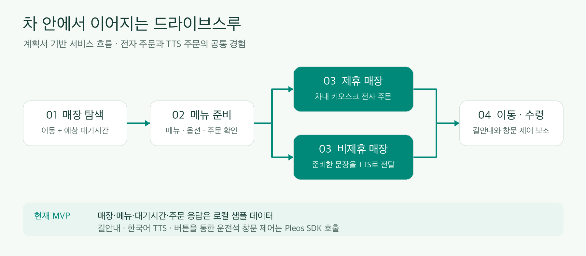
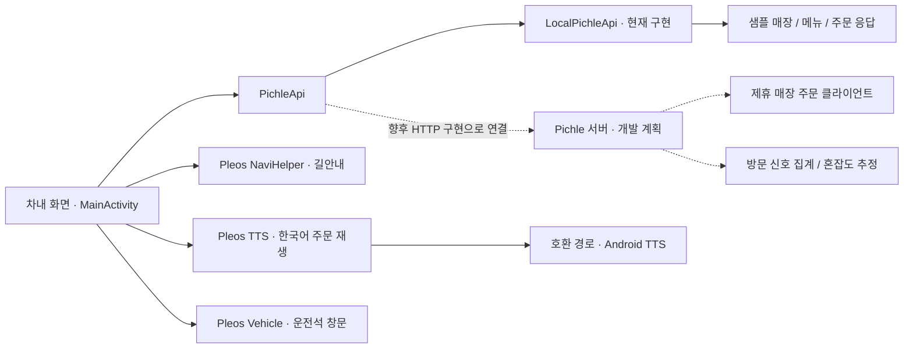
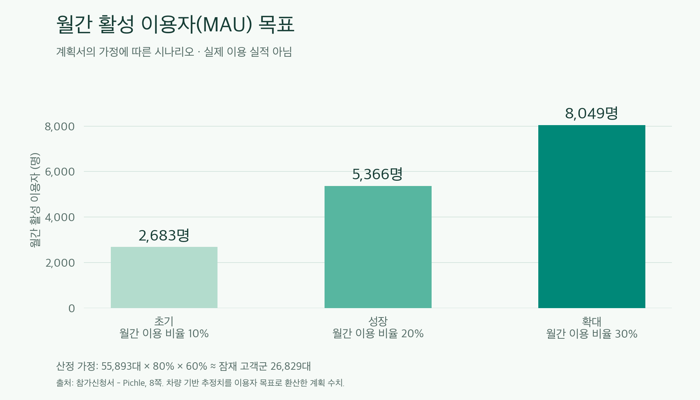
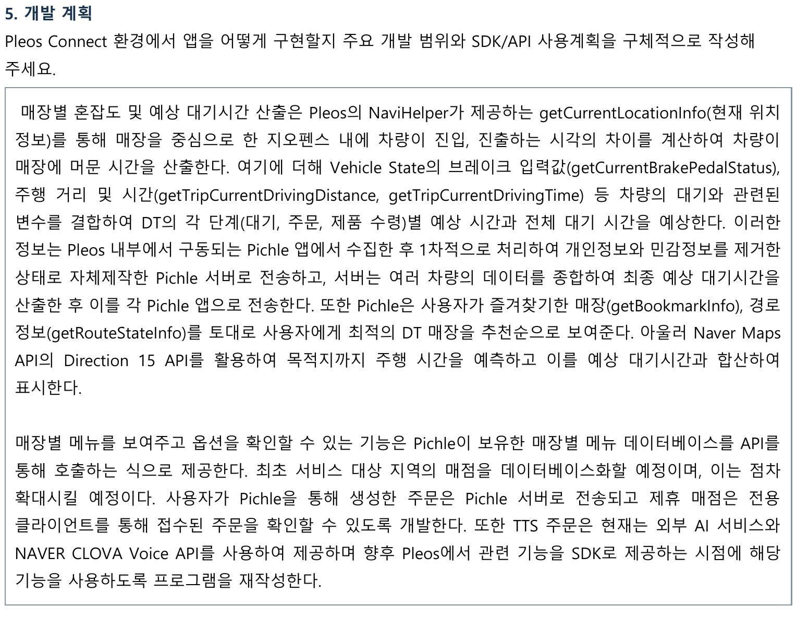

<div align="center">
  
  <h1>Pichle</h1>
  <p><strong>매장 탐색부터 주문과 수령까지, 차 안에서 이어지는 드라이브스루.</strong></p>
  <p>Pleos Connect 기반 차량용 드라이브스루 앱 · 현대자동차그룹 차량용 앱 개발 공모전</p>
</div>

Pichle은 차량 정보를 활용한 드라이브스루 혼잡도 추정, 차내 키오스크, TTS 주문을 통해 이동 중 구매 경험을 연결하는 프로젝트입니다. 매장까지의 이동시간과 예상 대기시간을 함께 비교하고, 차내 화면에서 메뉴를 준비해 매장의 주문 방식에 맞게 전달하는 것을 목표로 합니다.

이 저장소는 **Android MVP**입니다. 매장·메뉴·가격·대기시간·주문 접수는 로컬 샘플 데이터로 동작하며, 길안내·음성 출력·창문 제어는 실제 Pleos SDK를 호출합니다. 아래에서는 계획서의 서비스 구상과 현재 구현 범위를 함께 설명합니다.

## 기획 배경

드라이브스루를 선택하는 이유는 시간을 절약하기 위해서지만, 매장에 도착하기 전에는 얼마나 기다려야 하는지 판단하기 어렵습니다. 가까운 매장이라도 대기 줄이 길면 전체 소요시간이 늘어납니다. Pichle은 **거리뿐 아니라 이동과 대기에 걸리는 시간을 함께 비교하는 경험**에서 출발했습니다.

주문대 앞에서 메뉴와 옵션을 급히 결정해야 하는 부담도 줄이고자 합니다. 브랜드마다 다른 앱과 주문 방식을 익히는 대신, 차내 화면에서 메뉴를 충분히 살펴보고 주문 내용을 확인하는 공통 흐름을 제공합니다. 외국어로 즉석에서 주문하기 어렵거나 직접 말하기 어려운 이용자를 위해 전자 주문과 TTS를 활용하는 방식도 계획했습니다.

| 주요 이용자 | 필요한 경험 | Pichle의 서비스 방향 |
| --- | --- | --- |
| 출퇴근·장거리 이동 중인 운전자 | 일정에 맞는 매장 선택 | 이동시간과 예상 대기시간 비교 |
| 가족 단위 이용자 | 여러 메뉴와 옵션을 여유롭게 선택 | 출발 전·주차 상태에서 주문 준비 |
| 해외 여행·출장 이용자 | 낯선 언어로 주문하는 부담 완화 | 현지어 주문 문장과 다국어 TTS로 확장 |
| 직접 발화하기 어려운 이용자 | 선택한 내용을 스스로 전달 | 전자 주문 또는 준비된 문장의 음성 재생 |
| 청각장애인 이용자 | 음성에 의존하지 않는 접수 확인 | 제휴 매장의 전자 주문과 화면 상태 안내 |

## 서비스 흐름



*계획서의 서비스 구상을 바탕으로 작성한 흐름도입니다. 앱 실행 화면을 캡처한 이미지는 아닙니다.*

1. **매장 탐색** — 주변 드라이브스루의 이동시간과 예상 대기시간을 비교합니다.
2. **주문 준비** — 매장을 선택하고 메뉴·옵션·수량을 정한 뒤 장바구니를 확인합니다.
3. **주문 전달** — 제휴 매장은 전자 주문, 비제휴 매장은 준비한 주문 문장의 TTS 재생으로 이어집니다.
4. **매장 이동** — 차량 내비게이션으로 목적지까지 길안내를 요청합니다.
5. **상품 수령** — 접수 내역을 확인하고 수령 창구에 정차한 뒤 창문 제어를 요청합니다.

현재 앱의 화면 흐름은 `매장 목록 → 메뉴 → 옵션·수량 → 장바구니 → 주문 방법 → 주문 전송 / 음성 주문 → 이동 → 수령`입니다. 비제휴 매장은 장바구니에서 음성 주문 화면으로 바로 이어지며, 음성 재생·길안내·창문 제어는 각각 해당 단계의 화면에 배치했습니다.

## 주요 기능과 현재 구현

| 기능 | 계획서의 서비스 구상 | 현재 MVP |
| --- | --- | --- |
| 매장 탐색 | 주변 매장의 혼잡도와 전체 예상 소요시간 비교 | 가상 매장 목록, 이동·대기시간 합산 정렬, 카테고리 필터, 즐겨찾기 |
| 혼잡도 추정 | 지오펜스 체류시간, 브레이크·주행 정보를 집계해 대기시간 추정 | 고정된 샘플 대기시간 표시. 수집·집계·예측 모델은 미구현 |
| 차내 키오스크 | 메뉴·옵션 선택 후 제휴 매장으로 주문 전송 | 메뉴, 옵션, 수량, 장바구니, 로컬 접수 번호와 주문 내역 |
| TTS 주문 | 선택 내용을 자연어 문장으로 구성하고 현지어로 전달 | 정해진 형식으로 한국어 문장을 구성해 재생·중지. AI 문장 생성·번역은 미구현 |
| 길안내 | 차량 내비게이션과 연계한 매장 이동 | NaviHelper로 선택한 매장 좌표의 경로 탐색·내비게이션 화면 열기 |
| 수령 보조 | 수령 상황을 인지해 원하는 창문 제어 | 사용자가 버튼을 누르면 운전석 창문 내림 요청. 자동 정차 감지·자동 개방은 미구현 |

샘플 매장은 송도 지역의 예시 목적지 좌표를 사용합니다. 매장명·메뉴·가격은 가상 데이터이며, 좌표는 실제 매장 진입로로 검증되지 않았습니다. 현재 주문은 실제 매장으로 전달되지 않으며 결제 기능도 구현하지 않았습니다.

### Pleos에 특화된 경험

- **차량 데이터로 혼잡도 추정**: 계획서에서는 매장 주변 지오펜스의 진입·진출 시각, 브레이크 입력, 구간 주행거리와 시간을 조합해 대기·주문·수령 구간의 소요시간을 추정하도록 설계했습니다.
- **차내 화면과 음성으로 주문 준비**: 공통 메뉴 선택 화면에서 주문을 구성하고, 매장 연동 여부에 따라 전자 주문이나 음성 전달로 이어집니다.
- **길안내와 수령 보조 연결**: 별도 앱 전환을 줄이고 차량 내비게이션과 창문 제어 기능을 주문 흐름에 연결합니다.

혼잡도 추정용 데이터는 차량 안에서 먼저 처리하고, 서버에는 매장 단위의 비식별 구간 정보만 전달하는 방향입니다. 현재 `VisitSignal` 계약에는 사용자 ID, VIN, 정확한 좌표, 목적지, 전체 경로를 넣지 않습니다. 로컬 구현은 해당 정보를 외부로 전송하지 않습니다.

## 시스템 구성



실선은 현재 앱의 연결 구조, 점선은 향후 서버 연동 계획입니다. 계획서에서 검토한 Naver Maps Directions 15, 외부 AI 서비스와 NAVER CLOVA Voice는 현재 앱에 연결되어 있지 않습니다. 현재 음성 출력은 Pleos TTS를 우선 사용합니다.

### API 연결 계약 초안

현재 [PichleApi](app/src/main/java/ooo/ionya/driveaway/PichleApi.java)의 구현체는 [LocalPichleApi](app/src/main/java/ooo/ionya/driveaway/LocalPichleApi.java)입니다. 실제 서비스 연결 시 HTTP 구현체를 작성하고 앱에서 사용하는 구현체를 교체할 수 있습니다. 아래 엔드포인트는 제안 계약이며, 동작 중인 서버 API를 뜻하지 않습니다.

| 기능 | 제안 계약 | 주요 데이터 |
| --- | --- | --- |
| 주변 매장·혼잡도 | `GET /v1/stores?areaId={coarseAreaId}` | 매장, 거리, 이동분, 예상 대기분, 전자 주문 지원 여부 |
| 매장 메뉴 | `GET /v1/stores/{storeId}/menu` | 상품, 가격, 옵션 |
| 제휴 주문 | `POST /v1/orders` | 주문 요청, 주문 ID, 접수 상태, 픽업 안내 |
| 방문 신호 | `POST /v1/visit-signals` | 매장 ID, 구간 체류·정차·주행 시간과 거리 |

## 성장 목표와 확장 계획



*계획서 8쪽의 수치를 그래프로 재구성했습니다. 아래 수치는 계획서의 가정에 따른 추정·목표이며, 실제 출고 통계를 별도로 검증한 결과나 서비스 이용 실적이 아닙니다.*

계획서는 차량 55,893대에 음식점 방문 비율 80%와 DT 이용 비율 60%를 적용해 잠재 고객군을 약 **26,829대**로 추산합니다. 이를 기반으로 월간 이용 비율에 따라 이용자 목표를 설정했습니다. 차량 수를 이용자 수로 환산한 계획이므로 실제 이용자 수는 별도 검증이 필요합니다.

| 시나리오 | 가정한 월간 이용 비율 | MAU 목표 |
| --- | --- | --- |
| 초기 | 10% | 약 2,683명 |
| 성장 | 20% | 약 5,366명 |
| 확대 | 30% | 약 8,049명 |

초기 **30일 재방문율 목표는 25~35%**이며, 드라이브스루의 비정기적 이용 특성을 고려해 90일 재이용률도 함께 측정할 계획입니다.

개발은 다음 방향으로 확장하고자 합니다.

1. **매장·주문 연동** — 실제 메뉴 데이터베이스와 제휴 매장용 주문 접수 클라이언트를 연결합니다.
2. **혼잡도 예측** — 차량 내부에서 처리한 방문 신호를 집계하고, 매장별·시간대별 대기시간 추정을 검증합니다.
3. **주문 접근성 확대** — 다국어 메뉴·주문 문장·TTS를 도입하고 전자 주문의 화면 안내를 보강합니다.
4. **픽업 서비스 확장** — 매장의 상품 준비시간과 차량 도착시간을 연계하고 다양한 픽업 서비스로 넓힙니다.
5. **차량 에이전트와 연계** — 장기적으로 사용자의 승인과 허용된 운행 환경을 전제로 경로상 매장 추천과 주문 준비를 연결합니다.

## 기술 스택

| 구분 | 저장소 설정 |
| --- | --- |
| 앱 | Java, Android Views, AppCompat, Material Components |
| Android | 최소 SDK 28 / 컴파일·대상 SDK 37 |
| 빌드 | Android Gradle Plugin 9.4.0 / Gradle Wrapper 9.6.0 |
| 길안내 | Pleos NaviHelper 3.0.5 |
| 음성 출력 | Pleos TextToSpeech 3.3.1 / Android 한국어 TTS 호환 경로 |
| 차량 제어 | Pleos Vehicle 2.3.2 |
| 앱 버전 | `0.1.0` |

### 빌드 및 실행

Android Studio, Android SDK Platform 37과 Gradle 실행용 JDK가 필요합니다. Java 소스의 컴파일 대상은 11이며, 기존 프로젝트 실행 안내는 JDK 17 이상을 기준으로 합니다.

1. 저장소를 Android Studio에서 엽니다.
2. `local.properties`에 로컬 Android SDK 경로를 설정하고 Gradle을 동기화합니다. SDK 경로는 각 개발 환경에 맞게 지정합니다.
3. 다음 명령으로 디버그 APK를 생성합니다.

macOS / Linux:

```bash
./gradlew :app:assembleDebug
```

Windows PowerShell:

```powershell
.\gradlew.bat :app:assembleDebug
```

생성 경로: `app/build/outputs/apk/debug/app-debug.apk`

Pleos 길안내·음성·차량 제어는 해당 서비스를 제공하는 Pleos Connect 환경에서 확인해야 합니다. 일반 Android 환경의 동작은 서비스와 권한 지원 여부에 따라 달라집니다.

### 연동 동작과 검증 범위

- **NaviHelper**: 초기화와 리스너 등록 후 `requestRoute` → `requestNavigationScreen(Foreground)` 순으로 호출하고 결과 콜백을 확인합니다.
- **TTS**: `Mode.ON_DEVICE`로 Pleos 음성 출력을 요청합니다. 초기화·재생에 실패하면 Android 한국어 TTS로 전환하며 시작·완료·실패 상태를 표시합니다.
- **Vehicle**: 운전석(`ROW_1_LEFT`) 창문의 쓰기 지원과 위치 최댓값을 확인한 뒤 `setWindowPosition`을 호출합니다. 최대 8초 동안 현재 위치를 재조회하며 실제 값이 최댓값에 도달했을 때만 내림 완료로 표시합니다.

기존 프로젝트 기록상 Pleos Connect 2.1.0 에뮬레이터에서 음성 시작·완료와 목적지 경로 안내를 확인했습니다. 창문은 VHAL까지 쓰기 요청과 성공 응답을 받았으나 현재 위치가 계속 0으로 조회되어, 앱은 완료 대신 위치 변경 미확인을 안내합니다. **실차 동작은 검증하지 않았습니다.**

[기존 런타임 테스트](app/src/androidTest/java/ooo/ionya/driveaway/PleosRuntimeTest.java)는 TTS 재생, 창문 위치 피드백, 목적지 경로 탐색을 확인하며 에뮬레이터에서만 실행하도록 제한되어 있습니다.

필요한 Pleos 권한은 `TTS_SERVICE`, `NAVI_ROUTE_SEARCH`, `NAVI_CUSTOM_MAP`, `CAR_WINDOWS`, `CONTROL_CAR_WINDOWS`이며 모두 `pleos.car.permission.*` 접두사를 사용합니다. 실제 허용 여부와 지원 범위는 실행 플랫폼에 따릅니다. 창문 제어는 수령 화면에서 사용자가 버튼을 누를 때 호출합니다.

### 주요 코드

| 파일 | 역할 |
| --- | --- |
| [MainActivity.java](app/src/main/java/ooo/ionya/driveaway/MainActivity.java) | 화면 구성, 매장 탐색, 메뉴·장바구니·주문·수령 흐름 |
| [OrderFlow.java](app/src/main/java/ooo/ionya/driveaway/OrderFlow.java) | 화면 단계 정의 |
| [PichleApi.java](app/src/main/java/ooo/ionya/driveaway/PichleApi.java) | 매장·메뉴·주문·방문 신호 인터페이스 |
| [LocalPichleApi.java](app/src/main/java/ooo/ionya/driveaway/LocalPichleApi.java) | 로컬 샘플 데이터와 주문 응답 |
| [OrderSpeechController.java](app/src/main/java/ooo/ionya/driveaway/OrderSpeechController.java) | Pleos TTS와 Android TTS 재생 제어 |
| [PleosNavigation.java](app/src/main/java/ooo/ionya/driveaway/PleosNavigation.java) | 목적지 경로 탐색과 내비게이션 연동 |
| [PleosWindowController.java](app/src/main/java/ooo/ionya/driveaway/PleosWindowController.java) | 운전석 창문 제어와 위치 확인 |

## 계획서 원문 캡처

README의 기획 설명은 제출한 **「참가신청서 - Pichle」의 작품 소개 2~9쪽**을 바탕으로 정리했습니다. 원문에는 별도 그래프나 앱 화면 이미지가 없어, 위 흐름도와 MAU 그래프는 본문을 바탕으로 제작했습니다. 로고는 저장소의 기존 이미지를 사용했습니다.

**앱 한 줄 소개 · 2쪽**


<details>
<summary>개발 계획 원문 보기 · 6쪽</summary>



원문은 제안 당시의 개발 구상입니다. 외부 AI·CLOVA Voice 등의 연결 여부를 포함한 현재 구현 상태는 위의 ‘주요 기능과 현재 구현’ 및 ‘시스템 구성’을 기준으로 확인할 수 있습니다.

</details>

이미지 출처와 재생성 방법은 [시각 자료 안내](assets/readme/README.md)에 정리했습니다.

## 관련 문서

- [Pleos NaviHelper 목적지 안내](https://document.pleos.ai/en/docs/pleos-only/connect-sdk-pleos/NaviHelper/destinations)
- [Pleos TextToSpeech 소개](https://document.pleos.ai/en/docs/pleos-only/connect-sdk-pleos/TextToSpeech/intro)
- [Pleos 창문 위치 제어](https://document.pleos.ai/docs/pleos-only/connect-sdk-pleos/Vehicle/vehicle/ai.pleos.playground.vehicle.api/window/set-window-position)
